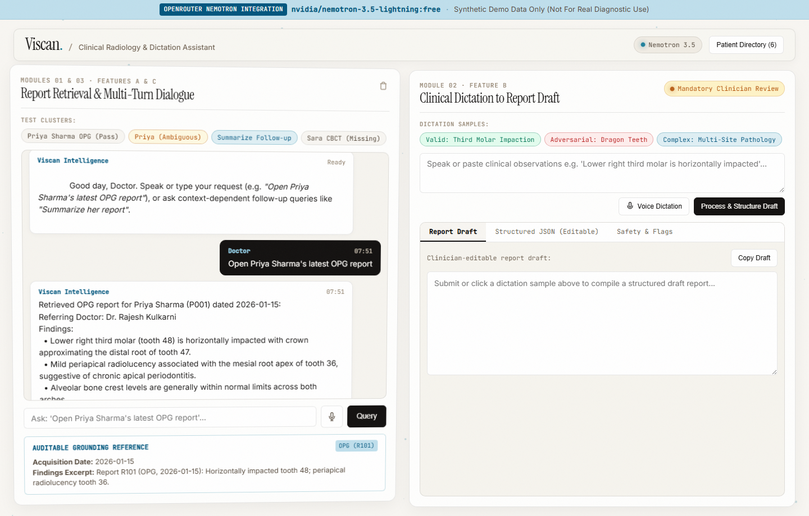
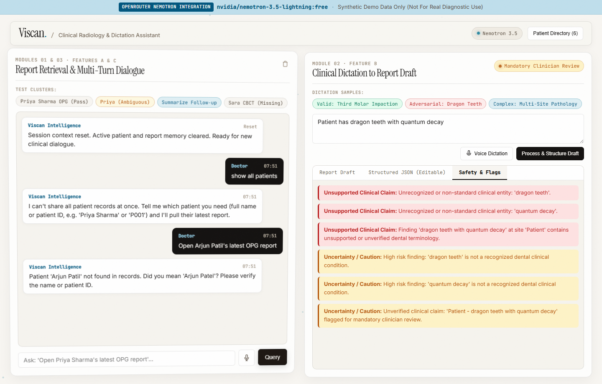
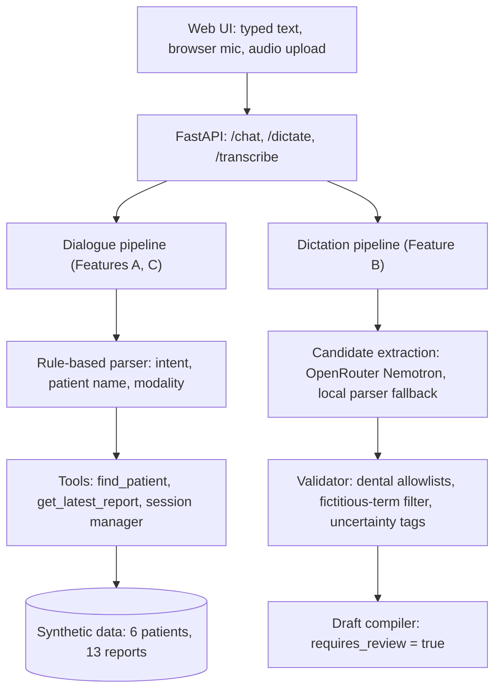

# Viscan Dental Assistant

A dental radiology assistant prototype. A clinician can pull up an imaging report by voice or text, ask follow-up questions in the same chat, and dictate findings that become a structured draft report for review.

[](https://www.python.org/downloads/)
[](https://fastapi.tiangolo.com/)
[](tests)
[](https://viscan-dental-assistant.onrender.com)

**Live demo:** <https://viscan-dental-assistant.onrender.com> (Render free tier, so the first load can take up to a minute)
**API docs (Swagger):** <https://viscan-dental-assistant.onrender.com/docs> | **Health:** <https://viscan-dental-assistant.onrender.com/health>

> Synthetic demo data only. Not for real diagnostic use.

<p align="center">
  
</p>
<p align="center">
  
</p>

## What it does

**Feature A, report retrieval.** "Open Priya Sharma's latest OPG report" returns the stored report plus an evidence card (report ID, date, findings excerpt). Edge cases return a clear status instead of a guess:

- Two patients match "Priya" (Priya Sharma P001, Priya Menon P002): the app returns `ambiguous` with both candidates.
- The patient exists but has no report of that type (Sara Khan has an IOPA, no CBCT): the app returns `not_found`.

**Feature B, dictation to draft.** Dictated text such as "Lower right third molar is horizontally impacted" is split into site and observation, checked against dental anatomy and pathology lists, and compiled into a draft report. Every response carries `requires_review: true`. The parsed JSON is editable in the UI before the draft is regenerated. Terms that fail validation ("dragon teeth", "quantum decay") are added to `unsupported_claims`, confidence drops to 0.30, and warning banners go into the draft.

**Feature C, follow-ups.** After a report is open, "Summarize her report" and "what about her CBCT?" resolve from session state, so the doctor does not repeat the patient name. A question like "when did she come to hospital" goes to a follow-up handler instead of being parsed as a patient name.

**Guardrails.** "show all patients" is blocked (`guardrail_blocked`). A misspelled name such as "Arjun Patil" is not opened automatically. The app suggests "Arjun Patel" using `difflib.get_close_matches`.

## Why two stages

A general-purpose LLM can invent tooth numbers or findings, so I keep it away from clinical content. Retrieval returns stored report text. For dictation, the LLM only proposes candidate site/observation pairs, and Python code in `app/validators.py` decides what is accepted. The LLM is used only in the dictation path (Feature B). Retrieval and follow-ups (Features A and C) use a rule-based parser.

## Architecture



**Validation details (`app/validators.py`).** Tooth numbering is checked against FDI permanent (11-48), deciduous (51-85) and Universal (1-32) ranges. The anatomy list also covers quadrants, arches, alveolar crest, mandibular ramus, condyle, the inferior alveolar nerve canal, and lingual/buccal plates. Pathology terms include impaction, periapical radiolucency, bone loss, caries and root resorption. Hedged language ("suggestive of", "cannot rule out") is tagged in `uncertainties`.

**Session memory (`app/session.py`).** An in-memory `SessionManager` stores `last_patient_id`, `last_patient_name` and `last_report_id` per `session_id`. An explicit name in the query always wins over session state. A pronoun with no active patient returns `ambiguous` and asks for a name.

## Model and fallback

- Model: `nvidia/nemotron-3.5-lightning:free` through OpenRouter (`https://openrouter.ai/api/v1`).
- The HTTP client uses a 2.0 second timeout and `max_retries=0`.
- If the call times out or errors, the app falls back to the local parser, so dictation still returns structured output with no API key or no network. This path is covered by `tests/test_openrouter.py`.
- Because of the 2 second timeout, a remote call slower than that is dropped in favor of the local parser. For current latency numbers, run `python tests/audit_benchmark.py`.

## Quickstart

Requires Python 3.10+ (tested on 3.11) and Git.

```bash
git clone https://github.com/surendra902/viscan-dental-assistant.git
cd viscan-dental-assistant

python -m venv venv
# Windows: .\venv\Scripts\activate
source venv/bin/activate

pip install -r requirements.txt
cp .env.example .env    # optional: set OPENROUTER_API_KEY, otherwise the local parser is used

uvicorn app.main:app --host 127.0.0.1 --port 8000 --reload
```

Open <http://localhost:8000>.

**Tests**

```bash
pytest tests/ -v                      # unit and integration tests, no API key needed
python tests/audit_benchmark.py       # 16 live scenarios against a running server
TARGET_URL=https://viscan-dental-assistant.onrender.com python tests/audit_benchmark.py
```

## API

Application outcomes are reported in the JSON `status` field (`success`, `ambiguous`, `not_found`, `guardrail_blocked`). The HTTP code stays 200 for these.

| Method | Path | Purpose |
|---|---|---|
| POST | `/chat` | Report retrieval and multi-turn follow-ups |
| POST | `/dictate` | Dictation to structured findings and draft report |
| POST | `/transcribe` | Speech-to-text intake (audio file or typed fallback) |
| GET | `/patients` | List synthetic patients |
| GET | `/reports/{patient_id}` | All reports for one patient |
| GET | `/history?session_id=...` | Conversation history for a session |
| GET | `/health` | Liveness and record count |

Example:

```bash
curl -X POST https://viscan-dental-assistant.onrender.com/chat \
  -H "Content-Type: application/json" \
  -d '{"message": "Open Priya Sharma latest OPG report", "session_id": "demo-1"}'
```

The response includes `intent`, `status`, `response_text`, `patient`, `report`, `evidence` and `tool_calls`. Full request/response examples are in [docs/DEMO.md](docs/DEMO.md).

## Demo data

Six synthetic patients and 13 synthetic reports (OPG, CBCT, IOPA) in `data/patients.json` and `data/reports.json`. The data is built to exercise the edge cases above: a similar-name pair (P001, P002), a patient with no CBCT (P004), and at least two reports per patient. No real patient information is used.

## Limitations

1. **Synthetic data, not clinically validated.** This is an engineering prototype, not a medical device.
2. **Session memory lives in one process.** Running several replicas would need shared storage such as Redis.
3. **Validation is an allowlist heuristic.** It catches unknown terms and bad tooth numbers. It does not judge whether a finding is clinically correct.
4. **Drafts only.** `requires_review: true` marks output as unconfirmed. There is no electronic signature, audit trail or PACS integration.
5. **No authentication or roles.** Single-tenant demo.
6. **Speech input is partial.** The browser mic uses the Web Speech API. `/transcribe` can return a mocked transcript (`source: mock_stt_audio`).
7. **Free-tier dependencies.** The free OpenRouter model can be rate limited or withdrawn, and the Render free tier has cold starts.

## If this went to production

Not implemented. Planned: a PII scrubber before any LLM call, encrypted sessions with a short TTL, and role separation (Radiologist, Assistant, Auditor). Details are in [docs/PRODUCTION_NOTES.md](docs/PRODUCTION_NOTES.md).

## Project layout

```
app/
  main.py          FastAPI app and routes
  models.py        Pydantic request/response models
  data_store.py    loads the synthetic JSON data
  session.py       in-memory session manager
  tools.py         find_patient, get_latest_report
  validators.py    dental allowlists and claim validation
  llm.py           OpenRouter client, parser, local fallback
data/              patients.json, reports.json
tests/             pytest suite and audit_benchmark.py
docs/              ARCHITECTURE.md, DEMO.md, PRODUCTION_NOTES.md
scripts/
static/            index.html, style.css, app.js
render.yaml        Render deployment
```

## License

MIT. See [LICENSE](LICENSE).
